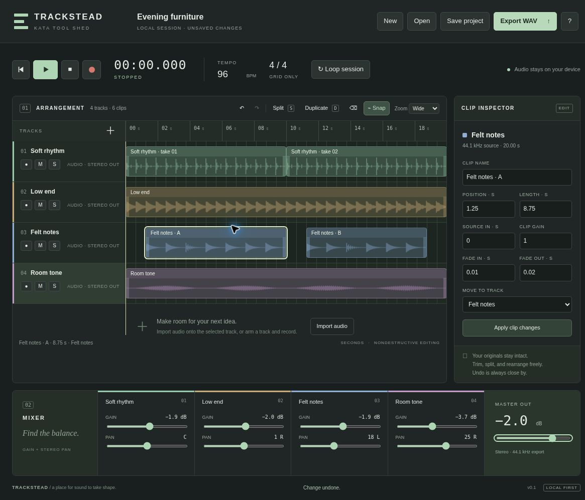

# Trackstead

**An original, local-first multitrack audio sketchbook for Kata Tool Shed.**

Trackstead explores the quick, linear recording and nondestructive arrangement workflow of a desktop DAW in a small browser app. It is inspired by REAPER's workflow, not a recreation of its interface, branding, proprietary code, or full feature set. It is not affiliated with Cockos or REAPER.



## Try it

- [Open Trackstead](https://intrepion.github.io/kata-app-inspired-by-reaper-codex-dot/)
- [Kata Tool Shed](https://intrepion.github.io/tools/)

## Run locally

Requires Node.js 18+ and a recent desktop browser with Web Audio. No dependency installation is required.

```sh
npm start
```

Open the printed localhost URL (default `http://127.0.0.1:4173`). **Use HTTP localhost, not a `file://` URL.** Microphone recording also works on HTTPS. Audio import codec support depends on the browser; PCM WAV is the most portable choice. Chrome/Edge are the primary prototype target. Mobile styling is provided, but precise arrangement is intended for desktop.

```sh
npm run check  # Syntax checks and Node test suite
npm run build  # Static app in dist/
```

The app is static and has no backend, accounts, analytics, network audio processing, external fonts, or runtime dependencies. The local Node server exists only to serve files. GitHub Pages hosts the static build. The checked-in workflow runs tests and builds before deploying main. No audio is sent to GitHub or another backend.

## First session

1. Press Play to hear **Evening furniture**, a 20-second original synthetic demo, generated locally with four mono sources.
2. Select a clip. Drag to move it in time or into another track. Drag its left/right edge to trim. Turn Snap off for free movement.
3. Click the seconds ruler to place the playhead. Press **S** to split the selected clip there. **D** duplicates it after itself. **Delete** removes it.
4. Use the inspector for exact position, source offset, duration, gain, fades, and destination track. Choose **Apply clip changes**.
5. Adjust per-track gain/pan, mute, and solo. Edit operations stop playback, so restart to hear the new mix.
6. **Save project** downloads a `.trackstead` file with its audio embedded. **Open** restores that file. **Export WAV** renders the current arrangement to a stereo 44.1 kHz / 16-bit WAV.

**Save before closing the page. There is no autosave.** A browser close warning is best-effort, not a backup. Save/export triggers a browser download, whose final location depends on browser settings.

### Import and record

Select a track by its name, then choose **Import audio**. File bytes stay in the browser. Importing places a clip at the playhead. Add tracks with the `+` button above the track list.

To record, arm one track using its `●` button and then click the red Record button. Only that explicit action requests browser microphone access. Stop finishes the take and releases the stream. Recording captures **microphone only**, without backing-track playback or live monitoring. Use headphones. Browser/OS input selection, latency, and codec support vary. Permission denial is handled without changing the session.

Actual microphone permission and hardware capture were deliberately not exercised in automated QA; see [verification](docs/VERIFICATION.md). This is not yet a production recorder.

### Keyboard

| Key | Action |
|---|---|
| Space | Play/pause; stop an active recording |
| S | Split selected clip at playhead |
| D | Duplicate selected clip |
| Delete / Backspace | Delete selected clip |
| Ctrl/Cmd Z | Undo |
| Ctrl/Cmd Shift Z | Redo |
| Ruler focused: arrows / Home | Move playhead by a beat / return to start |

Shortcuts do not intercept text fields or modal dialogs.

## Scope and honest limits

- Up to **12 tracks**, **120 clips**, and **5 minutes** of arrangement.
- Individual imports: up to **30 MB**, **120 seconds**, mono/stereo. Project files: up to **80 MB**. A cumulative decoded-audio guard limits memory use. Browsers may impose tighter limits.
- Editing references original audio buffers and does not overwrite your input files. The project file embeds 16-bit PCM copies, so saving/reopening can quantize higher-bit-depth inputs. The browser also resamples decoded imports/project audio to its AudioContext sample rate. Retain your original source files for archival quality.
- Clip timing is in seconds. Tempo and 4/4 affect the beat grid only; they do **not** time-stretch or detect tempo. Loop repeats the entire session and is not guaranteed gapless.
- No MIDI editor, instrument rack, sequencer, plug-ins/VSTs, automation, routing buses, spectral repair, time stretching, pitch correction, comping, punch recording, multichannel interface capture, metronome, live input monitor, latency compensation, streaming disk engine, or REAPER `.rpp` compatibility.
- Mixer changes apply on the next playback. Overlapping clips sum. WAV export warns if samples clip; there is no limiter, normalization, or mastering chain.
- Source waveforms display a sampled peak approximation, not a precision sample editor. Audio hardware output and microphone recording require further real-device testing.
- Undo/redo holds up to 60 in-memory session states. Imported sources remain available to undo. Saving/reopening releases unused sources but resets history. Starting a new session clears all sources and undo history after confirmation.

**Position within the Tool Shed:** Trackstead is the linear multitrack arrangement/recording tool. Wave Room is the focused audio-file editor. The FL-inspired app is the pattern/beat composition tool. Keeping these jobs separate makes the prototypes useful without pretending to be full DAWs.

## Code map

- `src/model.js`: session model, edit operations, project validation, WAV encoding.
- `src/audio.js`: Web Audio playback, offline rendering, original demo synthesis.
- `src/app.js`: interface, clip editing, local files, transport, recorder lifecycle.
- `src/style.css`: original responsive studio UI.
- `tests/`: model and audio scheduling tests using the Node test runner.
- `docs/RESEARCH.md`: workflow research and source links.
- `docs/VERIFICATION.md`: checks performed and known testing gaps.
- `docs/screenshots/`: genuine local-browser captures, not mockups.

## License and assets

MIT. All application code, CSS identity, and built-in synthesized demo audio are original to this project. No REAPER assets, logos, screenshots, themes, source code, or commercial recordings are included. REAPER is a trademark of Cockos Incorporated. The inspiration is acknowledged for context, not endorsement.
